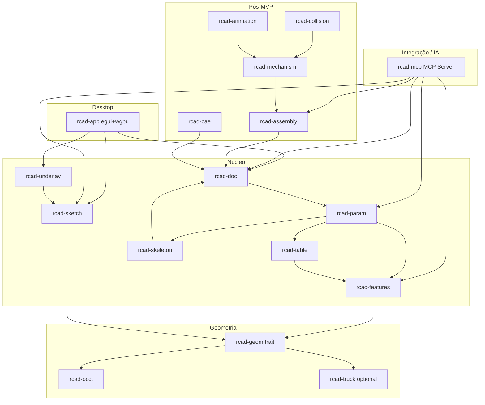

## Estado real (2026-10-17) — ler primeiro

> **O plano ativo é o ciclo de fundação:** [plans/foundation-plan.md](plans/foundation-plan.md)
> (A render → B curvas analíticas → C referências/pai-filho, com D performance a acompanhar).
> Este documento continua a ser o **âmbito de produto de longo prazo**. As marcações ✅ do
> corpo abaixo são **históricas** e sobrestimam o estado em vários pontos; a tabela seguinte é
> a fotografia real no commit `b898185`.

| Área | Estado real |
|---|---|
| Projeto, `rcad.toml`, recentes, auto-open, cores por projeto | ✅ Feito. Tolerâncias, variáveis globais, funções e tabelas externas são lidas mas **ainda não aplicadas** |
| Barra vertical + painel de histórico | ✅ Feito (tabs, colapsar, ícones/texto, dock, suppress, Insert Here/Rollback **marcadores**, drag-reorder, parâmetros/relações). ❌ Falta o overlay com blur, remover a barra de menus e honrar Insert Here/Rollback no rebuild |
| Sketcher | ✅ Feito: desenho com rato, constraints, dimensões, DOF por rank, tabela de constraints, Free DOF, DXF/SVG, undo |
| Nomes estáveis e reparação de referências | ✅ Feito (com catálogo de roles ainda incompleto nalgumas features) |
| Underlay | ⚠️ Só crate (`rcad-underlay`); não está ligada à app |
| Skeletons | ⚠️ Só crate (`rcad-skeleton`); sem UI |
| Assembly | ⚠️ Só crate; solver alinha origens, não B-Rep; só 3 mates persistem; sem UI |
| Renderer 3D | ❌ Ainda é o `egui::Painter` (sem depth); é o Bloco A da fundação |
| Curvas/furos no sólido | ❌ `Profile2D` polígonal; círculos/arcos não chegam ao kernel; Bloco B |
| Pai/filho, Insert Here/Rollback reais, Edit Definition | ❌ Parcial; Bloco C |
| Multi-body | ❌ Campos no documento, sem uso |
| Desenho 2D, trail log, associações de ficheiros | ❌ Não implementados |

### Fase A/B/C do corpo (histórico)

As secções “Fase A/B/C” abaixo dizem **CONCLUÍDA**; isso refere-se ao núcleo de modelação e
sketch da altura, não ao estado atual. Usar a tabela acima como fonte de verdade.

---
## Confirmação do âmbito

# rcad — CAD paramétrico open-source em Rust

| Decisão          | Valor                                                                                                      |
| ---------------- | ---------------------------------------------------------------------------------------------------------- |
| Horizonte de uso | ~6 meses (MVP utilizável, não “paridade Creo/Fusion”)                                                      |
| Equipa           | Nós primeiro; open-source modular assim que houver POC                                                     |
| Plataforma       | Desktop Linux/Windows/macOS agora; WASM depois                                                             |
| Stack            | Preferir OSS existente (wgpu, egui, OCCT, solvers, etc.)                                                   |
| Prioridades      | 1 modelação+skeletons → 1.1 reverse eng. → 2 assemblagens → 3 mecanismos → 4 colisões → 5 timeline → 6 CAE |
| Repositório      | **[bfonseca/Rcad](https://github.com/bfonseca/Rcad)** já criado — não criar repo novo; trabalhar nesse remote |
    * **Otimização UI:** Lay-out vertical lateral para ecrãs 16:9 / 16:10.
    * **Gestão de Projeto:** Ficheiro manifesto `rcad.toml` na raiz.
    * **Tabelas Externas:** Leitura nativa de ficheiros Excel/CSV.

**Expectativa realista:** em 6 meses não haverá paridade com Creo/Fusion. O objectivo é uma aplicação desktop com a qual já se possa modelar peças paramétricas, usar skeletons, importar imagens com escala, e ter a base modular para a comunidade. Assemblagens entram no final do semestre se o núcleo estiver estável; mecanismos/CAE ficam desenhados na arquitectura mas implementados depois.

**Projecto:** `rcad` (repo GitHub: [bfonseca/Rcad](https://github.com/bfonseca/Rcad)). Clone/trabalho local em [`/home/bruno/Projectos/Rcad`](/home/bruno/Projectos/Rcad) apontando para esse remote. Licença recomendada: **Apache-2.0 OR MIT** no código nosso; respeitar **LGPL-2.1** do OCCT (distribuição com possibilidade de relink).

---

## Arquitectura modular

Workspace Cargo com crates independentes (cada um publicável depois no crates.io / contribuição separada):

### Stack fechada (sem alternativas em aberto)

| Camada                     | Escolha                                                                                                                                      | Motivo                                                          |
| -------------------------- | -------------------------------------------------------------------------------------------------------------------------------------------- | --------------------------------------------------------------- |
| UI                         | `eframe` + `egui`                                                                                                                            | Rápido para POC desktop; comunidade Rust forte                  |
| Viewport 3D                | `wgpu` (WebGPU)                                                                                                                              | Desktop agora, caminho natural para WASM depois                 |
| Math                       | `glam`                                                                                                                                       | Alinhado com egui/wgpu                                          |
| Kernel BREP principal      | **OCCT** via crate Rust (`cadrum` como 1.ª opção de integração; fallback `opencascade`/`opencascade-rs` se a API do cadrum for insuficiente) | Sólidos/superfícies, sew/thicken, STEP, tessellation industrial |
| Kernel auxiliar            | **Truck** (`truck-modeling` / meshalgo) atrás do mesmo trait `rcad-geom`, opcional                                                           | Experimentos pure-Rust / malhas; não bloqueia o MVP             |
| Constraints 2D/3D          | `rust_slvs` (SolveSpace)                                                                                                                     | Sketches e mates futuros                                        |
| Física / colisões (fase 4) | `rapier3d`                                                                                                                                   | Tempo real; Nexus só se surgir necessidade clara                |
| CAE (fase 6)               | CalculiX / OpenFOAM como **processos externos** + adaptadores de mesh/BC                                                                     | Não reimplementar solvers FEA/CFD                               |
| Formato nativo             | Documento versionado (MessagePack ou CBOR + schema) + export STEP/STL via OCCT                                                               | Interop industrial desde cedo                                   |
| Imagens underlay           | `image` + textura wgpu; calibração de escala no UI                                                                                           | Prioridade 1.1                                                  |
| Parsing de Tabelas         | `calamine`                                                                                                                                   | Para ler ficheiros `.xlsx` e `.csv`                             |
| Shaders wgpu               | Shaders personalizados                                                                                                                       | Para efeitos de *blur* na árvore de histórico                   |
| Extensões de ficheiro      | `.rcad` (projeto), `.rcadprt` (peça), `.rcadskl` (skeleton), `.rcadasm` (assemblagem), `.rcadlog` (trail)                                 | Convenção curta, consistente, registável no OS                  |
| MCP Server (IA)            | `mcp-rs` (crate `rcad-mcp`, binário separado)                                                                                                | Resources/tools/prompts para modelação; transporte stdio/TCP    |

Trait `GeometryBackend` em `rcad-geom`: criar sólido/superfície, booleanos, extrude/revolve/loft/sweep, fillet/chamfer, sew → solid, thicken, tessellate, STEP I/O. O app só fala com o trait; o backend OCCT é o default.

---

## Modelo de dados (núcleo)

- **Documento:** projecto → peças / assemblagens / skeletons.
- **Peça:** feature tree (DAG paramétrico) → bodies (sólido / superfície / construção).
- **Feature:** tipo + parâmetros + referências a entities (faces/edges/vertices estáveis via IDs de histórico, o melhor possível com OCCT naming/history).
- **Skeleton:** peça especial com planos, eixos, pontos, curvas e solids de referência; bodies de produção referenciam o skeleton (top-down design estilo Creo).
- **Rebuild:** `rcad-param` reavalia a árvore; cache de shapes por feature; dirty propagation.

Isto é o “coração” do MVP — sem feature tree estável o resto não escala.

---

## Parametrização e Metodologia Creo

### Intent Manager no Sketcher

O **Intent Manager** gere a transição entre restrições fracas (geradas automaticamente) e fortes (definidas pelo utilizador):

- **Cotas Fracas (Weak Dimensions):** Criadas automaticamente pelo solver `rust_slvs` para garantir que o sketch nunca fica sub-restringido. São visualmente distintas (ex: cor cinza, linha tracejada) e podem ser promovidas a fortes.
- **Cotas Fortes (Strong Dimensions):** Introduzidas explicitamente pelo utilizador. Substituem automaticamente as cotas fracas correspondentes.
- **Restrições Virtuais Temporárias:** Geridas internamente pelo `rcad-sketch` para estabilizar a solução durante a edição interativa.

### Workflow de Skeletons (Top-Down Design)

Mecanismos explícitos inspirados no Creo:

- **Publish Geometry:** No skeleton, o utilizador seleciona entidades de construção (planos, eixos, pontos, curvas, sólidos de referência) e publica-as com nomes semânticos.
- **Copy Geometry:** Na peça filha, o utilizador referencia o skeleton e escolhe quais geometrias publicadas copiar. As referências mantêm associatividade: alterações no skeleton propagam para as peças filhas.
- **External References:** Gestão de dependências externas com indicador visual de estado (atualizado / desatualizado / quebrado).

**Intenção:** Assegurar que a modelação paramétrica é previsível e robusta a alterações, evitando falhas em cadeia ao redefinir dimensões.

---

### Subsecção: Gestão de Projeto via `rcad.toml`
Adição do esquema e exemplo em TOML do manifesto de projeto.
Inclusão dos campos de tolerância geral (`general_tolerance`) e parâmetros globais.

### Subsecção: Mapeamento de Cores de Superfície por Cliente
Inclusão de especificação onde os tipos lógicos de superfície (ex: roscas, superfícies de ajuste, zonas de vedação) são associados a valores RGB definidos no `rcad.toml`.

### Subsecção: Componentes Guiados por Tabelas Externas
Especificação da ligação entre a feature da peça e tabelas externas (`.xlsx`/`.csv`) para validação e extração de dimensões.

## Ambiente Gráfico e UI/UX

### Barra de Ferramentas Vertical Dockable:
* Posição padrão à esquerda com capacidade de transferência para a direita (*dockable*).
* Alternância de vista: *Apenas Ícones* vs. *Ícones + Texto*.

### Árvore de Histórico Híbrida Adaptativa:
* Funcionamento em *Overlay* transparente diretamente sobre o Viewport 3D.
* **Comportamento Interativo:** Quando o cursor do rato entra na zona da árvore, o fundo escurece ligeiramente e aplica um efeito de *blur* via `wgpu` para máxima legibilidade; fora dessa zona, torna-se 100% transparente com texto suavizado, permitindo plena navegação 3D.
* Estruturação estrita estilo Creo (*Parent/Child*, modo *Insert Here*, *Suppress/Resume*, *Edit Definition*).

**Intenção:** Aproveitar ao máximo a área vertical dos monitores modernos (16:9), oferecendo uma experiência de trabalho limpa, imersiva e sem distrações visuais, combinando a clareza do Creo com a estética do CATIA.

## MVP a 6 meses (utilizável)

### Fase A — Fundação (semanas 1–4) ✅ **CONCLUÍDA**

- Scaffold workspace no repo `rcad` + CI (build Linux, clippy, testes básicos).
- `rcad-app`: janela egui, viewport wgpu (orbit/pan/zoom), grelha, seleção por picking de mesh.
- `rcad-doc` + serialização mínima (abrir/guardar projecto, MessagePack/CBOR).
- Integração OCCT: primitiva → tessellate → mostrar no viewport; export STL/STEP.
- **Pendente (movido para tarefas UI):** layout 16:9 com barra vertical dockable; árvore transparente adaptativa com shader de *blur*; parser inicial do `rcad.toml` (tolerâncias globais e cores RGB por cliente).

### Fase B — Modelação paramétrica + skeletons (semanas 5–14) — prioridade 1 ✅ **CONCLUÍDA**

- Sketch 2D: linhas/arcos/círculos, cotas e constraints via solver iterativo + `rust_slvs` placeholder, planos de sketch.
- Features sólidas mínimas: Extrude, Revolve, Boolean (union/cut/intersect), Fillet/Chamfer básicos, planos/eixos/pontos de construção.
- Multi-body numa peça; tree UI (reordenar / suprimir / editar parâmetros → rebuild).
- Superfícies básicas: extrude surface, loft, boundary + **Sew** e **Thicken** (superfície → sólido).
- **Skeletons:** criar skeleton part, publicar geometria de referência (Publish Geometry), criar peça filha que consome referências (Copy Geometry), gestão de referências externas.
- **Intent Manager:** cotas fracas/fortes, restrições virtuais temporárias, análise de DOF, status de constraint.
- **Pendente:** integração completa `rcad-table` com features; `rust_slvs` SolveSpace backend completo.

### Fase C — Engenharia reversa por imagem (semanas 10–16, em paralelo com B) — prioridade 1.1 ✅ **CONCLUÍDA**

- Import PNG/JPEG/SVG rasterizado como underlay num plano.
- Definição de escala (dois pontos + distância real).
- Opacidade, bloqueio, alinhamento ao sketch activo; tracing manual sobre a imagem.
- Rotação, ordem de exibição, snap a features, conversão world↔pixel.

### Fase D — Assemblagens mínimas (semanas 15–22) — prioridade 2 🔄 **EM ANDAMENTO**

- Inserir instâncias de peças; hierarquia; mates básicos (coincident / concentric / distance) com solver `rust_slvs`.
- Exploded view simples opcional; não exigir skeletons de movimento ainda.
- **Estado:** crate `rcad-assembly` existe mas é placeholder; precisa implementação.

### Fase E — Fecho "usável" (semanas 20–26) 🔄 **EM ANDAMENTO**

- Estabilidade de rebuild, undo/redo ✅, atalhos ✅, documentação de contribuição.
- POC anunciável: README ✅, licenças ✅, roadmap ✅, issues etiquetadas `good first issue` por crate ⏳.
- Smoke tests e 2–3 modelos de exemplo (peça + skeleton + underlay + assembly simples) ⏳.

**Critério de sucesso aos 6 meses:** modelar uma peça paramétrica multi-feature, usar skeleton + underlay com escala, montar 2–3 peças com mates básicos, gravar/reabrir e exportar STEP/STL.

### Tarefas Transversais (UI/Integração) — **PENDENTES**

- **UI-1:** Barra de ferramentas vertical dockable (ícones/texto) + árvore de histórico overlay com blur wgpu.
- **UI-2:** Parser `rcad.toml` no `rcad-app` (tolerâncias, cores RGB por cliente, tabelas externas).
- **UI-3:** Aplicar mapeamento de cores RGB por tipo de superfície no viewport.
- **UI-4:** Conectar `rcad-table` a features/partes para parametrização por CSV/Excel.

### Novas Funcionalidades de Projeto e Integração — **PENDENTES**

- **PRJ-1:** Inicialização do projeto — se não houver projeto, pedir para criar; gerenciar "recent projects" em `~/.config/rcad/recent.json` (max 10); auto-abrir último projeto na inicialização.
- **PRJ-2:** Trail log (auditoria/debug) — JSON Lines (`.rcadlog`) no diretório do projeto com: timestamp, action, params, result, duration. Futuro: modo "replay" para replicar sessão.
- **PRJ-3:** Extensões de ficheiro padronizadas — `.rcad` (projeto), `.rcadprt` (peça), `.rcadskl` (skeleton), `.rcadasm` (assemblagem), `.rcadlog` (trail). Registo de associação no OS (Linux `.desktop`/MIME, macOS UTI, Windows registry).
- **PRJ-4:** MCP Server (`rcad-mcp` crate, binário separado) — usar `mcp-rs`; expor resources (project/parts/sketches), tools (create_part, add_sketch, extrude, revolve, boolean, create_assembly, add_mate, export_step/stl), prompts (workflows comuns); transporte stdio/TCP para uso headless/CI.

---

## Roadmap pós-MVP (arquitectura reservada, implementação depois)

| Prioridade | Módulo           | Conteúdo                                                                                                             |
| ---------- | ---------------- | -------------------------------------------------------------------------------------------------------------------- |
| 3          | `rcad-mechanism` | Joints (revolute, slider, cylindrical…), motores, actuação manual (drag) vs prescrita                                |
| 4          | `rcad-collision` | Broad/narrow phase Rapier sobre meshes de colisão derivadas da tessellation; feedback em tempo real                  |
| 5          | `rcad-animation` | Timeline + keyframes editáveis; em qualquer frame disparar pedidos de análise (API async)                            |
| 6          | `rcad-cae`       | Adaptadores: malha → CalculiX (estrutural/fadiga/térmico) e OpenFOAM (fluidos); resultados como overlays no viewport |

WASM: após API `rcad-geom` estável; alvo secundário com backend OCCT-wasm ou Truck conforme maturidade — **não** no caminho crítico dos 6 meses.

---

## Organização open-source

- Monorepo em [bfonseca/Rcad](https://github.com/bfonseca/Rcad) (velocidade); crates com `README` e limites claros de API.
- Contribuição por módulo: labels `crate:geom`, `crate:sketch`, etc.
- POC anunciável à comunidade quando Fase A+B tiverem demo gravável (o remote já existe; não esperar assemblagens para o primeiro anúncio).
- Política: features grandes só via trait/adapters; sem acoplar UI a OCCT directamente.

---

## Riscos e mitigações

| Risco                                                   | Mitigação                                                                     |
| ------------------------------------------------------- | ----------------------------------------------------------------------------- |
| API Rust do OCCT incompleta (fillet, history, surfaces) | Camada `rcad-occt` com FFI/cxx pontual onde o wrapper falhar; issues upstream |
| Rebuild paramétrico / naming de faces frágil            | IDs estáveis próprios + testes de regressão em modelos golden                 |
| Scope creep “paridade Fusion”                           | Freeze de features do MVP; backlog estrito por prioridade                     |
| LGPL OCCT                                               | Documentar obrigações; manter OCCT relinkável                                 |
| 1–2 pessoas / 6 meses                                   | Cortar superfícies avançadas, sheet metal, drawings 2D, CAM                   |

| Risco                                                   | Mitigação                                                                     |
| ------------------------------------------------------- | ----------------------------------------------------------------------------- |
| Performance do efeito de *blur* na árvore de histórico  | Uso de shader leve em `wgpu` ativado estritamente durante eventos de *hover*. |
| Complexidade na gestão de cotas fracas no solver 2D     | Geração de restrições virtuais temporárias geridas pelo `rcad-sketch`.        |

---

## Primeiros passos de execução (após aprovação do plano)

1. Clonar [bfonseca/Rcad](https://github.com/bfonseca/Rcad) para [`/home/bruno/Projectos/Rcad`](/home/bruno/Projectos/Rcad) (se ainda não existir localmente) e alinhar com o remote — **não** fazer `git init` de um repo novo.
2. `move_agent_to_root` para esse directório e, se o repo estiver vazio ou só com README, criar o workspace Cargo com as crates `rcad-*`.
3. Implementar Fase A (viewport + OCCT hello-solid) e iterar Fase B/C conforme o critério de sucesso acima.