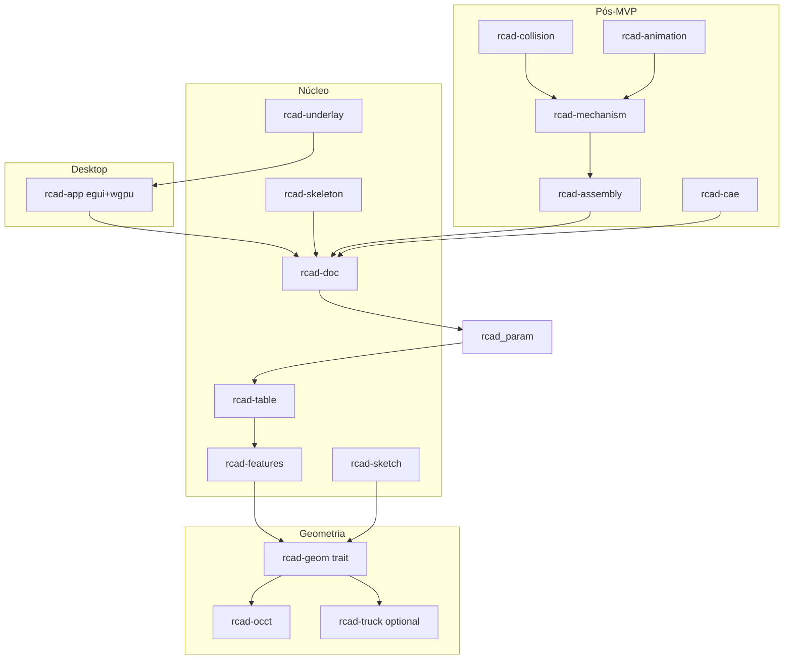

## Confirmação do âmbito

# rcad — CAD paramétrico open-source em Rust

| Decisão          | Valor                                                                                                      |
| ---------------- | ---------------------------------------------------------------------------------------------------------- |
| Horizonte de uso | ~6 meses (MVP utilizável, não “paridade Creo/Fusion”)                                                      |
| Equipa           | Nós primeiro; open-source modular assim que houver POC                                                     |
| Plataforma       | Desktop Linux/Windows/macOS agora; WASM depois                                                             |
| Stack            | Preferir OSS existente (wgpu, egui, OCCT, solvers, etc.)                                                   |
| Prioridades      | 1 modelação+skeletons → 1.1 reverse eng. → 2 assemblagens → 3 mecanismos → 4 colisões → 5 timeline → 6 CAE |
| Repositório      | **[bfonseca/Rcad](https://github.com/bfonseca/Rcad)** já criado — não criar repo novo; trabalhar nesse remote |
    * **Otimização UI:** Lay-out vertical lateral para ecrãs 16:9 / 16:10.
    * **Gestão de Projeto:** Ficheiro manifesto `rcad.toml` na raiz.
    * **Tabelas Externas:** Leitura nativa de ficheiros Excel/CSV.

**Expectativa realista:** em 6 meses não haverá paridade com Creo/Fusion. O objectivo é uma aplicação desktop com a qual já se possa modelar peças paramétricas, usar skeletons, importar imagens com escala, e ter a base modular para a comunidade. Assemblagens entram no final do semestre se o núcleo estiver estável; mecanismos/CAE ficam desenhados na arquitectura mas implementados depois.

**Projecto:** `rcad` (repo GitHub: [bfonseca/Rcad](https://github.com/bfonseca/Rcad)). Clone/trabalho local em [`/home/bruno/Projectos/Rcad`](/home/bruno/Projectos/Rcad) apontando para esse remote. Licença recomendada: **Apache-2.0 OR MIT** no código nosso; respeitar **LGPL-2.1** do OCCT (distribuição com possibilidade de relink).

---

## Arquitectura modular

Workspace Cargo com crates independentes (cada um publicável depois no crates.io / contribuição separada):

### Stack fechada (sem alternativas em aberto)

| Camada                     | Escolha                                                                                                                                      | Motivo                                                          |
| -------------------------- | -------------------------------------------------------------------------------------------------------------------------------------------- | --------------------------------------------------------------- |
| UI                         | `eframe` + `egui`                                                                                                                            | Rápido para POC desktop; comunidade Rust forte                  |
| Viewport 3D                | `wgpu` (WebGPU)                                                                                                                              | Desktop agora, caminho natural para WASM depois                 |
| Math                       | `glam`                                                                                                                                       | Alinhado com egui/wgpu                                          |
| Kernel BREP principal      | **OCCT** via crate Rust (`cadrum` como 1.ª opção de integração; fallback `opencascade`/`opencascade-rs` se a API do cadrum for insuficiente) | Sólidos/superfícies, sew/thicken, STEP, tessellation industrial |
| Kernel auxiliar            | **Truck** (`truck-modeling` / meshalgo) atrás do mesmo trait `rcad-geom`, opcional                                                           | Experimentos pure-Rust / malhas; não bloqueia o MVP             |
| Constraints 2D/3D          | `rust_slvs` (SolveSpace)                                                                                                                     | Sketches e mates futuros                                        |
| Física / colisões (fase 4) | `rapier3d`                                                                                                                                   | Tempo real; Nexus só se surgir necessidade clara                |
| CAE (fase 6)               | CalculiX / OpenFOAM como **processos externos** + adaptadores de mesh/BC                                                                     | Não reimplementar solvers FEA/CFD                               |
| Formato nativo             | Documento versionado (MessagePack ou CBOR + schema) + export STEP/STL via OCCT                                                               | Interop industrial desde cedo                                   |
| Imagens underlay           | `image` + textura wgpu; calibração de escala no UI                                                                                           | Prioridade 1.1                                                  |
| Parsing de Tabelas | `calamine` | Para ler ficheiros `.xlsx` e `.csv` |
| Shaders wgpu | Shaders personalizados | Para efeitos de *blur* na árvore de histórico |

Trait `GeometryBackend` em `rcad-geom`: criar sólido/superfície, booleanos, extrude/revolve/loft/sweep, fillet/chamfer, sew → solid, thicken, tessellate, STEP I/O. O app só fala com o trait; o backend OCCT é o default.

---

## Modelo de dados (núcleo)

- **Documento:** projecto → peças / assemblagens / skeletons.
- **Peça:** feature tree (DAG paramétrico) → bodies (sólido / superfície / construção).
- **Feature:** tipo + parâmetros + referências a entities (faces/edges/vertices estáveis via IDs de histórico, o melhor possível com OCCT naming/history).
- **Skeleton:** peça especial com planos, eixos, pontos, curvas e solids de referência; bodies de produção referenciam o skeleton (top-down design estilo Creo).
- **Rebuild:** `rcad-param` reavalia a árvore; cache de shapes por feature; dirty propagation.

Isto é o “coração” do MVP — sem feature tree estável o resto não escala.

---

### Subsecção: Gestão de Projeto via `rcad.toml`
Adição do esquema e exemplo em TOML do manifesto de projeto.
Inclusão dos campos de tolerância geral (`general_tolerance`) e parâmetros globais.

### Subsecção: Mapeamento de Cores de Superfície por Cliente
Inclusão de especificação onde os tipos lógicos de superfície (ex: roscas, superfícies de ajuste, zonas de vedação) são associados a valores RGB definidos no `rcad.toml`.

### Subsecção: Componentes Guiados por Tabelas Externas
Especificação da ligação entre a feature da peça e tabelas externas (`.xlsx`/`.csv`) para validação e extração de dimensões.

## Ambiente Gráfico e UI/UX

### Barra de Ferramentas Vertical Dockable:
* Posição padrão à esquerda com capacidade de transferência para a direita (*dockable*).
* Alternância de vista: *Apenas Ícones* vs. *Ícones + Texto*.

### Árvore de Histórico Híbrida Adaptativa:
* Funcionamento em *Overlay* transparente diretamente sobre o Viewport 3D.
* **Comportamento Interativo:** Quando o cursor do rato entra na zona da árvore, o fundo escurece ligeiramente e aplica um efeito de *blur* via `wgpu` para máxima legibilidade; fora dessa zona, torna-se 100% transparente com texto suavizado, permitindo plena navegação 3D.
* Estruturação estrita estilo Creo (*Parent/Child*, modo *Insert Here*, *Suppress/Resume*, *Edit Definition*).

**Intenção:** Aproveitar ao máximo a área vertical dos monitores modernos (16:9), oferecendo uma experiência de trabalho limpa, imersiva e sem distrações visuais, combinando a clareza do Creo com a estética do CATIA.

## MVP a 6 meses (utilizável)

### Fase A — Fundação (semanas 1–4)

- Scaffold workspace no repo `rcad` + CI (build Linux, clippy, testes básicos).
- `rcad-app`: janela egui, viewport wgpu (orbit/pan/zoom), grelha, seleção por picking de mesh.
- `rcad-doc` + serialização mínima (abrir/guardar projecto).
- Integração OCCT: primitiva → tessellate → mostrar no viewport; export STL/STEP.
- **Novidades:** desenvolvimento do layout 16:9 com barra vertical dockable; implementação da árvore transparente adaptativa com shader de *blur*; parser inicial do `rcad.toml` (tolerâncias globais e cores RGB por cliente).

### Fase B — Modelação paramétrica + skeletons (semanas 5–14) — prioridade 1

- Sketch 2D: linhas/arcos/círculos, cotas e constraints via `rust_slvs`, planos de sketch.
- Features sólidas mínimas: Extrude, Revolve, Boolean (union/cut/intersect), Fillet/Chamfer básicos, planos/eixos/pontos de construção.
- Multi-body numa peça; tree UI (reordenar / suprimir / editar parâmetros → rebuild).
- Superfícies básicas (ex.: extrude surface, boundary/loft simples se OCCT permitir na API exposta) + **Sew** e **Thicken** (superfície → sólido).
- **Skeletons:** criar skeleton part, publicar geometria de referência, criar peça filha que consome essas referências.
- **Novidades:** inclusão da crate `rcad-table` para suporte a tabelas Excel; implementação do *Intent Manager* no Sketcher (cotas fracas vs. fortes).

### Fase C — Engenharia reversa por imagem (semanas 10–16, em paralelo com B) — prioridade 1.1

- Import PNG/JPEG/SVG rasterizado como underlay num plano.
- Definição de escala (dois pontos + distância real).
- Opacidade, bloqueio, alinhamento ao sketch activo; tracing manual sobre a imagem (não OCR/auto-mesh 3D nesta fase).

### Fase D — Assemblagens mínimas (semanas 15–22) — prioridade 2

- Inserir instâncias de peças; hierarquia; mates básicos (coincident / concentric / distance) com solver.
- Exploded view simples opcional; não exigir skeletons de movimento ainda.

### Fase E — Fecho “usável” (semanas 20–26)

- Estabilidade de rebuild, undo/redo, atalhos, documentação de contribuição em [bfonseca/Rcad](https://github.com/bfonseca/Rcad).
- POC anunciável: README, licenças, roadmap, issues etiquetadas `good first issue` por crate.
- Smoke tests e 2–3 modelos de exemplo (peça + skeleton + underlay + assembly simples).

**Critério de sucesso aos 6 meses:** modelar uma peça paramétrica multi-feature, usar skeleton + underlay com escala, montar 2–3 peças com mates básicos, gravar/reabrir e exportar STEP/STL.

---

## Roadmap pós-MVP (arquitectura reservada, implementação depois)

| Prioridade | Módulo           | Conteúdo                                                                                                             |
| ---------- | ---------------- | -------------------------------------------------------------------------------------------------------------------- |
| 3          | `rcad-mechanism` | Joints (revolute, slider, cylindrical…), motores, actuação manual (drag) vs prescrita                                |
| 4          | `rcad-collision` | Broad/narrow phase Rapier sobre meshes de colisão derivadas da tessellation; feedback em tempo real                  |
| 5          | `rcad-animation` | Timeline + keyframes editáveis; em qualquer frame disparar pedidos de análise (API async)                            |
| 6          | `rcad-cae`       | Adaptadores: malha → CalculiX (estrutural/fadiga/térmico) e OpenFOAM (fluidos); resultados como overlays no viewport |

WASM: após API `rcad-geom` estável; alvo secundário com backend OCCT-wasm ou Truck conforme maturidade — **não** no caminho crítico dos 6 meses.

---

## Organização open-source

- Monorepo em [bfonseca/Rcad](https://github.com/bfonseca/Rcad) (velocidade); crates com `README` e limites claros de API.
- Contribuição por módulo: labels `crate:geom`, `crate:sketch`, etc.
- POC anunciável à comunidade quando Fase A+B tiverem demo gravável (o remote já existe; não esperar assemblagens para o primeiro anúncio).
- Política: features grandes só via trait/adapters; sem acoplar UI a OCCT directamente.

---

## Riscos e mitigações

| Risco                                                   | Mitigação                                                                     |
| ------------------------------------------------------- | ----------------------------------------------------------------------------- |
| API Rust do OCCT incompleta (fillet, history, surfaces) | Camada `rcad-occt` com FFI/cxx pontual onde o wrapper falhar; issues upstream |
| Rebuild paramétrico / naming de faces frágil            | IDs estáveis próprios + testes de regressão em modelos golden                 |
| Scope creep “paridade Fusion”                           | Freeze de features do MVP; backlog estrito por prioridade                     |
| LGPL OCCT                                               | Documentar obrigações; manter OCCT relinkável                                 |
| 1–2 pessoas / 6 meses                                   | Cortar superfícies avançadas, sheet metal, drawings 2D, CAM                   |

| Risco                                                   | Mitigação                                                                     |
| ------------------------------------------------------- | ----------------------------------------------------------------------------- |
| Performance do efeito de *blur* na árvore de histórico  | Uso de shader leve em `wgpu` ativado estritamente durante eventos de *hover*. |
| Complexidade na gestão de cotas fracas no solver 2D     | Geração de restrições virtuais temporárias geridas pelo `rcad-sketch`.        |

---

## Primeiros passos de execução (após aprovação do plano)

1. Clonar [bfonseca/Rcad](https://github.com/bfonseca/Rcad) para [`/home/bruno/Projectos/Rcad`](/home/bruno/Projectos/Rcad) (se ainda não existir localmente) e alinhar com o remote — **não** fazer `git init` de um repo novo.
2. `move_agent_to_root` para esse directório e, se o repo estiver vazio ou só com README, criar o workspace Cargo com as crates `rcad-*`.
3. Implementar Fase A (viewport + OCCT hello-solid) e iterar Fase B/C conforme o critério de sucesso acima.