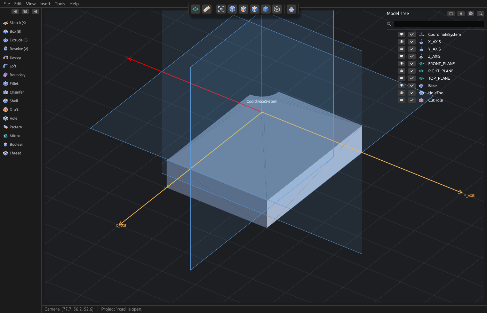
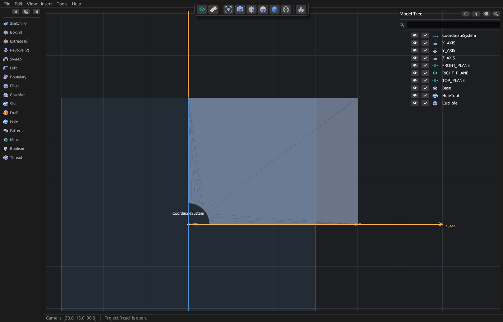
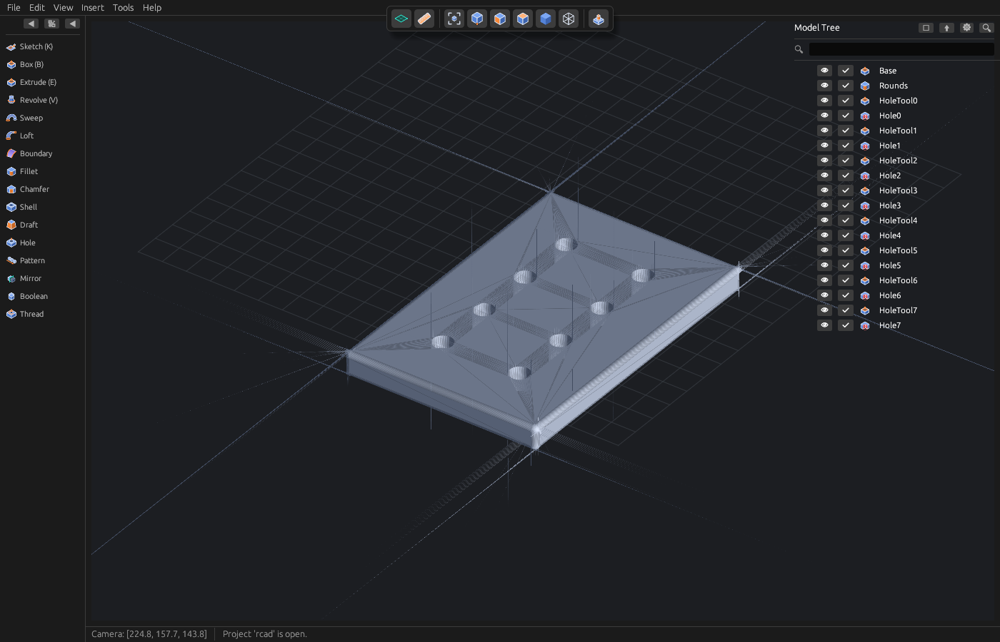
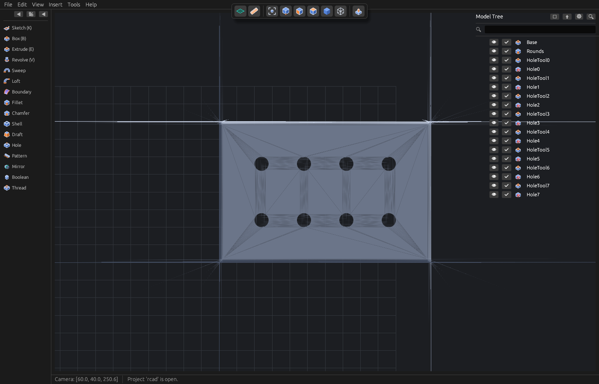
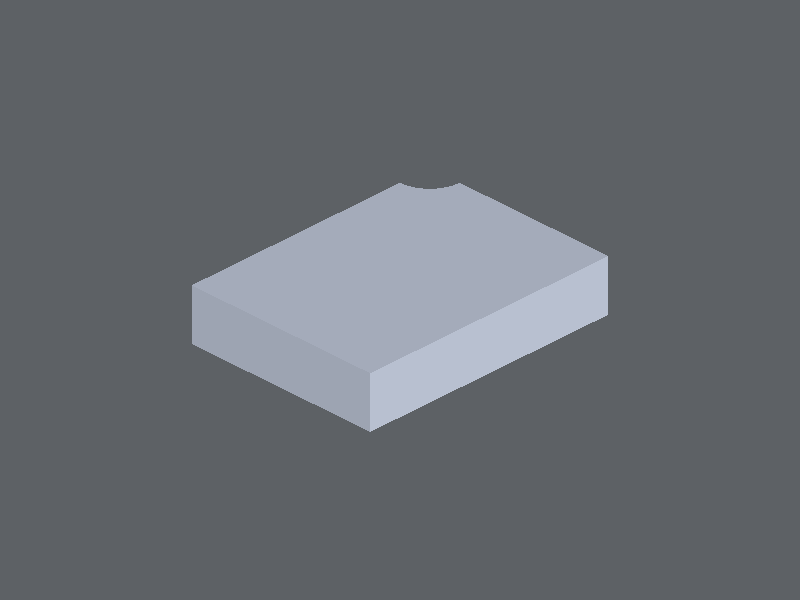
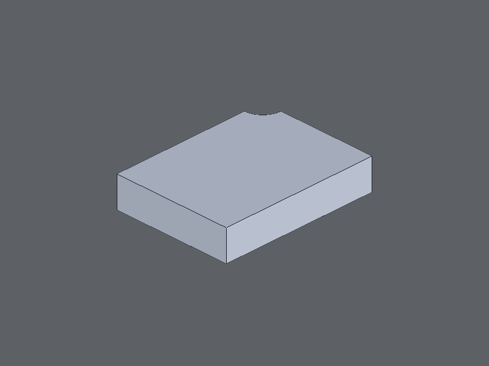
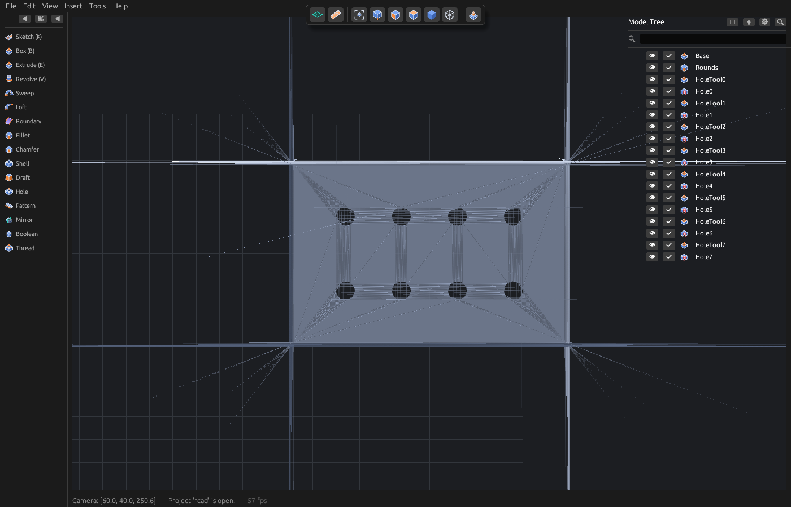

# Fundação — Baseline A0 (2026-10-17)

> **Estado:** A0 concluído. Este documento congela o “antes” do ciclo de fundação:
> imagens, tamanhos de malha, tempos de rebuild, tesselação, picking e frame time.
> Os números são a referência contra a qual os Blocos A–D serão medidos.
>
> **Onde correu:** mesma máquina de desenvolvimento, renderer `glow` (software,
> `LIBGL_ALWAYS_SOFTWARE=1 GALLIUM_DRIVER=llvmpipe`), X11, janela 1400×900.
> Sem `/dev/dri` visível: **não há GPU** neste ambiente, por isso os tempos de
> frame são de software rasterizer e não representam o hardware do utilizador.
> Os tempos de kernel/rebuild são independentes do renderer e são os números
> relevantes para D.

---

## 1. Como reproduzir

```bash
# 1) Gerar as peças de teste e medir rebuild/tesselação
cargo run --release --example foundation_bench
RCAD_BENCH_RUNS=1 RCAD_BENCH_SCALING=1 cargo run --release --example foundation_bench

# 2) Imagens de referência (software GL, X11)
LIBGL_ALWAYS_SOFTWARE=1 GALLIUM_DRIVER=llvmpipe \
  cargo run --release -p rcad-app -- --project . --demo --view iso \
  --renderer glow --frames 20 --screenshot docs/baseline/demo-iso.png

LIBGL_ALWAYS_SOFTWARE=1 GALLIUM_DRIVER=llvmpipe \
  cargo run --release -p rcad-app -- --project . \
  --open examples/models/foundation_plate.rcad --view iso \
  --renderer glow --frames 20 --screenshot docs/baseline/plate-iso.png

# 3) Custo do picking (release, 180k triângulos)
cargo test --release -p rcad-app baseline_picking_cost -- --ignored --nocapture

# 4) Frame time (diferença entre 10 e 70 frames no demo)
#    ver os comandos na secção 5
```

As peças `examples/models/foundation_demo.rcad` e `foundation_plate.rcad` são
geradas pelo exemplo `foundation_bench` e ficam no repositório como fixtures
para imagens e gates futuros. Regenerar com o comando acima.

---

## 2. Imagens de referência

| Imagem | O que mostra |
|---|---|
|  | Demo atual (caixa + corte cilíndrico), vista iso. Sólido pequeno, sem arestas de contorno. |
|  | Demo, vista de topo. |
|  | Chapa de teste: 120×80×10, 8 furos, rounds. |
|  | Chapa, vista de topo. **Nota:** as “linhas” sobre a face são costuras entre triângulos do `egui::Painter`, não arestas B-Rep — prova visual do problema que o Bloco A resolve. |

Observações visuais do “antes”:
- Não há arestas de contorno (shaded with edges) — só o preenchimento.
- A face superior triangulada mostra costuras/hairlines e triângulos longos
  (triangulação em leque em volta dos furos). É o painter sem depth/MSAA.
- O cilindro do furo é desenhado com facetas; não há sombreado suave.
- A chapa demora ~23 s a capturar porque o rebuild síncrono/assíncrono ainda
  está a correr; antes do ajuste de captura (ver §6) a imagem saía **vazia**.

---

## 3. Tamanho da malha e custo de rebuild

Peça média = chapa 120×80×10 com rounds + N furos (círculos poligonais de 32
lados, como o pipeline atual os produz). Uma reconstrução “cold” = `ShapeCache`
novo. “Incremental” = segunda chamada com o mesmo cache.

| Peça | Features | Triângulos | Vértices | Cold (ms) | Incremental (ms) | 2.ª tesselação (ms) |
|---|---:|---:|---:|---:|---:|---:|
| demo (caixa + 1 furo) | 3 | 48 | 62 | 15,0 | 6,0 | 3,5 |
| chapa 0 furos (só rounds) | 2 | 2 116 | 1 328 | 61,4 | 39,5 | 23,5 |
| chapa 2 furos | 6 | 2 380 | 1 712 | 938,1 | 481,2 | 247,3 |
| chapa 4 furos | 10 | 2 644 | 2 096 | 3 391,3 | 1 511,3 | 795,2 |
| **chapa 8 furos (peça de teste)** | **18** | **3 172** | **2 864** | **≈15 000** | **≈5 250** | **≈2 770** |

Leitura:
- O custo **não** acompanha o número de triângulos (3 172 triângulos, 15 s):
  acompanha a complexidade topológica e o número de operações.
- Duplicar os furos multiplica o rebuild por ~4 → crescimento **superlinear**
  (O(n²) ou pior), não linear.
- A **segunda tesselação** (que inclui recalcular nomes/histórico de todas as
  faces e arestas) custa ~2,8 s na chapa de 8 furos. O resto (~12 s) está na
  avaliação das features e na derivação de referências por feature.
- O rebuild “incremental” ainda custa ~35% do cold: o cache de shapes não evita
  a re-tesselação/nomeação nem todo o trabalho por feature.
- Suspeita principal (a confirmar em D2): para cada feature, o rebuild deriva
  topologia e referências de todas as faces/arestas do corpo; e o cálculo do
  ângulo diedral usa uma classificação de sólido OCCT (`solid.contains`) por
  aresta. Ambos crescem com o corpo e são repetidos nas operações seguintes.

**Implicação:** o Bloco B (curvas analíticas) deve reduzir drasticamente esta
conta: um furo cilíndrico passa de ~32 faces laterais + ~32 arestas de topo para
**1 face cilíndrica + 2 arestas**. Ainda assim, D tem de remover o custo
superlinear antes de a app ser usável com peças reais (uma peça de 50 features
seria proibitiva).

---

## 4. Picking

Teste `rcad-app::viewport::tests::baseline_picking_cost` (ignorado por omissão):

| Métrica | Valor |
|---|---|
| Triângulos na malha sintética | 180 000 |
| Picks medidos | 200 (200 acertos) |
| Média por pick (release) | **1,09 ms** |

O picking atual é uma travessia linear de todos os triângulos, mas a 180k
triângulos ainda está perto de 1 ms. Conclusão: **não é o gargalo imediato**;
BVH/GPU picking continua útil para malhas grandes (D1), mas não bloqueia o
Bloco A. O comportamento a preservar é o atual (aresta > datum > face, ciclo com
botão direito).

---

## 5. Frame time (renderer)

Medido pela diferença entre uma captura de 10 e uma de 70 frames (o arranque
cancela):

| Cena | 10 frames | 70 frames | Δ / 60 | ms/frame | FPS aprox. |
|---|---:|---:|---:|---:|---:|
| demo | 263 ms | 789 ms | 526 ms | **8,8 ms** | ~114 |
| chapa 8 furos | — | — | — | **~8,4 ms*** | ~119 |

\* A chapa demora ~23,7 s por captura porque o rebuild (15 s) corre antes de a
imagem ser tirada; o log regista 2 827 frames nesse intervalo → ~8,4 ms/frame
durante o rebuild. Não é possível medir a diferença 10↔70 frames com precisão
porque a variância do rebuild (~0,4 s) é maior do que o efeito dos 60 frames.

Leitura: **o renderer de software não é o gargalo** para estas malhas (≈8–9 ms
por frame a 1400×900). O gargalo é o rebuild. O Bloco A é sobretudo uma
**correção de qualidade visual** (depth, MSAA, arestas, sombreamento suave), não
uma otimização de FPS. Num GPU real espera-se muito mais folga.

> **Nota pós-A1 (2026-10-17):** o A1 ligou MSAA 4×, depth 24 e stencil 8. No
> llvmpipe o frame time da chapa passou para ~18 ms; em GPU o custo é muito
> menor. Os números desta secção são o “antes” (sem MSAA) e **não devem ser
> comparados diretamente** com medições feitas depois do A1 sem notar a
> configuração. Os tempos de rebuild/tesselação e de picking não são afetados.

---

## 6. Correções de infraestrutura feitas durante o A0

1. **Captura de ecrã espera pelo modelo.** O `--screenshot` tirava a imagem ao
   fim de N frames; com uma peça cujo rebuild demora segundos, a imagem saía
   **vazia** (“No solid — add a feature”). Agora espera pela primeira
   tesselação, com um limite de 120 s para nunca pendurar o CI.
   Alteração em `crates/rcad-app/src/app.rs` (`CaptureRequest`, `handle_capture`).
2. **Exemplo de baseline** `foundation_bench` (peças demo e chapa, medições e
   gravação dos `.rcad`), registado em `examples/Cargo.toml`.
3. **Teste de picking** ignorado por omissão, para medição reproduzível.

Estas alterações não mudam geometria nem comportamento de modelação; só tornam
a medição e as imagens reproduzíveis.

---

## 7. Orçamentos iniciais propostos para D (a validar depois do Bloco B)

| Métrica | Hoje | Alvo inicial | Alvo final (pós-B/D) |
|---|---:|---:|---:|
| Rebuild demo (cold) | 15 ms | ≤ 50 ms | ≤ 25 ms |
| Rebuild chapa 8 furos (cold) | ~15 000 ms | ≤ 3 000 ms (só com B) | ≤ 500 ms |
| Rebuild chapa 8 furos (incremental) | ~5 250 ms | ≤ 1 000 ms | ≤ 100 ms |
| 2.ª tesselação chapa 8 furos | ~2 770 ms | ≤ 800 ms | ≤ 150 ms |
| Picking 180k triângulos | 1,09 ms | ≤ 2 ms | ≤ 1 ms |
| Frame time (software, demo) | 8,8 ms | ≤ 16,7 ms | ≤ 16,7 ms |

Os alvos “finais” são deliberadamente ambiciosos; serão revistos com os números
do Bloco B. O importante é que fiquem **registados** e que cada bloco meça
antes/depois.

---

## 8. A5 — qualidade de tesselação (medido)

A5 tornou a tesselação configurável no `rcad.toml` (`[tessellation]`) e no
Options dialog, e baixou o default de cadrum (0,004 relativo, 0,5 rad ≈ 28,65°)
para **0,002 relativo e 11,5°**. A mesma peça, só com a qualidade alterada:

| Peça | Triângulos (antes) | Triângulos (depois) | Cold rebuild (antes → depois) |
|---|---:|---:|---:|
| demo | 48 | 76 (+58%) | 15,4 → 15,7 ms |
| chapa 8 furos | 3 172 | 5 076 (+60%) | 16 335 → 16 300 ms |

Conclusão: enquanto o rebuild for dominado pelo trabalho por feature/naming,
**+60% de triângulos custa ~2% do tempo** — a qualidade visual extra é
praticamente gratuita. A medição deve ser repetida depois de B/D.

Os nomes de faces/arestas usam uma tesselação **canónica fixa**, por isso mudar
a qualidade nunca invalida referências:
`rcad-occt::tests::display_tessellation_changes_triangles_but_not_reference_names`.

## 9. A2 — validação headless do pipeline

Sem uma janela WGPU neste ambiente, o pipeline foi validado em três níveis:

1. **WGSL**: `the_solid_shader_parses_and_validates` (naga; apanhou um erro real
   de `front_facing` no estágio errado antes de existir GPU).
2. **Pipeline/draw**: `headless_pipeline_draws_a_triangle` cria o pipeline com
   depth e desenha um triângulo, exercitando a validação do wgpu.
3. **Caminho real `prepare`+`paint`**: `headless_render_of_the_demo_writes_a_png`
   usa o adapter GL headless do llvmpipe, a malha real da demo (OCCT) e grava
   `target/a2-headless-demo.png` — o sólido aparece sombreado, com o corte
   cilíndrico e sem faces traseiras.



A **janela** WGPU real foi entretanto confirmada pelo utilizador no seu desktop (render
muito melhor do que antes), e o Gate A foi aprovado visualmente em 2026-10-17. O contador
de FPS passou a estar no status bar para registar o primeiro número no próximo arranque.
Neste ambiente de comandos o `Surface::configure` continua a falhar.

## 10. A4 — arestas B-Rep (offscreen)

O A4 acrescentou o segundo passe de arestas: linhas B-Rep com depth test, bias negativo para
evitar z-fighting e classificação de tangentes pelo ângulo diedral. O render offscreen do demo
passou a mostrar o contorno escuro das arestas visíveis, com as traseiras escondidas:



Confirmado na janela do utilizador em 2026-10-17 (as arestas foram consideradas corretas).
O painter continua a desenhar a linha grossa de seleção/hover por cima.

## 11. B — curvas analíticas (resultado)

A chapa de teste deixou de usar círculos poligonais: cada furo é agora um **cilindro real**
(`Profile2D::circle` → `Edge::circle`). A geometria ficou correta e o rebuild caiu:

| Peça | Cold antes (B) | Cold depois | Incremental antes → depois |
|---|---:|---:|---:|
| chapa 2 furos | 938 ms | 146 ms | 481 → 58 ms |
| chapa 4 furos | 3 391 ms | 225 ms | 1 511 → 71 ms |
| **chapa 8 furos** | **15 240 ms** | **425 ms** | **5 262 → 103 ms** |

Isto é **~36× mais rápido** na peça de teste, porque a topologia deixou de ter ~32 faces por
furo. Os triângulos sobem de 5 076 para 6 068 (cilindro verdadeiramente curvo), custo que o A5
já tinha medido como ~2% do tempo de rebuild antes de B.

Compatibilidade: documentos antigos abrem e migram automaticamente (o `Deserialize` de
`Profile2D` converte as listas de pontos em linhas; `format_version` passou para 2). Uma chapa
pré-B foi aberta e reconstruída na app para validar isto.

A chapa reconstruída com furos cilíndricos, vista de topo (fallback glow; o contador do status
bar mostra 57 fps em software):



## 12. Próximo passo

**Bloco C** — referências, pai/filho e rebuild condicionado. O Bloco A está fechado
(Gate A aprovado) e o Bloco B está concluído no núcleo; Loft/Boundary e BSpline
ficam como follow-up. O “antes” continua congelado nas imagens desta página.
